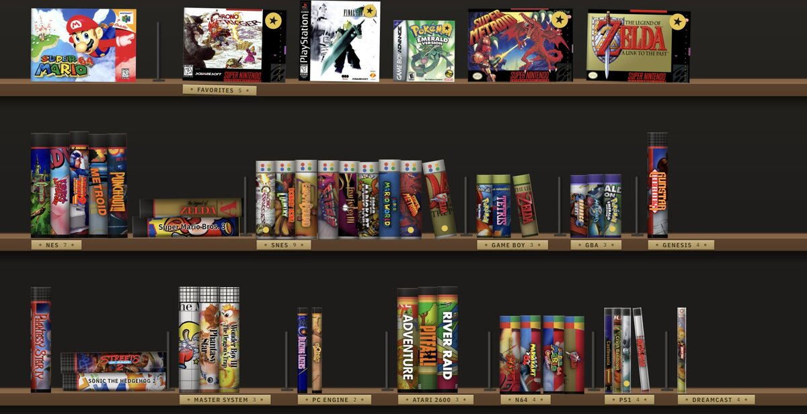

<p align="center">
  
</p>

<h1 align="center">The Retro Shelf</h1>

<p align="center">
  Your retro game collection as real boxes on a shelf.<br>
  Emulators built in. Games not included.
</p>

<p align="center">
  <a href="https://github.com/colingalbraith/the-retro-shelf/releases"></a>
  <a href="https://github.com/colingalbraith/the-retro-shelf/releases"></a>
  <a href="https://github.com/colingalbraith/the-retro-shelf/actions/workflows/test.yml"></a>
  
  <a href="LICENSE"></a>
  <a href="https://github.com/colingalbraith/the-retro-shelf/stargazers"></a>
</p>

<p align="center">
  
</p>

Drag your games onto the window and they land on the right shelf with their box art, ready to play with a
keyboard or controller. RetroArch and its cores come inside the app, so there's nothing else to set up.

## Features

- **A real shelf:** every console has its own box style, with spine art and logos from the game's cover.
- **Pull a box out to play,** or turn it over to see last played, playtime and your saves.
- **Drag-and-drop import** that works out which console each file is for.
- **Pick up where you left off:** leaving a game saves your spot.
- **Art and details are automatic:** covers, logos, year, publisher and genre for 38,000+ games.
- **Controllers just work:** Xbox, PlayStation and Switch Pro.
- **Updates itself** in the background.
- **Private:** no account, no tracking.

<table>
  <tr>
    <td width="50%"></td>
    <td width="50%"></td>
  </tr>
</table>

## Download

Grab the latest version from [Releases](https://github.com/colingalbraith/the-retro-shelf/releases):

- **Mac with Apple silicon** (M1 and newer): `mac-arm64.dmg`. **Mac with Intel**: `mac-x64.dmg`. Open it and drag
  The Retro Shelf into Applications. Not sure which Mac you have? Apple menu → About This Mac: "Chip" means
  Apple silicon, "Processor" means Intel.
- **Windows** 10 and 11: run the `Setup .exe`.

After that it updates itself.

The app isn't signed yet, so the first launch needs one extra click. On a **Mac**, go to System Settings →
Privacy & Security and click **Open Anyway**. On **Windows**, click **More info → Run anyway**.

> [!NOTE]
> This is an early beta. [Bug reports](https://github.com/colingalbraith/the-retro-shelf/issues) are welcome.

## Getting games

No games are included, and the app doesn't link to sites that hand out commercial games. Instead you can copy
cartridges and discs you own, play free homebrew, or buy official re-releases. The app has a guide to all of
these under **Help → Where to Get Games**.

**Supported:** NES, SNES, Game Boy / Color / Advance, Genesis, Master System, Game Gear, PC Engine, Atari 2600,
N64, DS, PlayStation, PSP, Dreamcast, GameCube / Wii and Arcade (FinalBurn Neo). PS2 works if you install PCSX2
yourself.

## Controls

| Keyboard | Controller | |
| --- | --- | --- |
| Arrows | D-pad | Browse |
| Enter | A | Play |
| Space | Y | Turn box over |
| F | X | Favorite |
| Esc | B | Back |

In a game, hold **Start** or press **Esc** to return to the shelf.

## Build from source

You need [Node.js 22](https://nodejs.org).

```sh
npm install
npm run fetch:mac   # or fetch:win: downloads RetroArch and the cores
npm start
npm test
npm run dist:mac    # or dist:win
```

Pushing a `v*` tag builds the installers in GitHub Actions and attaches them to a draft release. Publishing it is
what the app's updater picks up.

## License

[GPL-3.0-or-later](LICENSE). The bundled RetroArch and cores keep their own licenses
([THIRD_PARTY_NOTICES.md](THIRD_PARTY_NOTICES.md)). Some cores are non-commercial, so the app can't be sold.
Box art comes from libretro-thumbnails and belongs to its owners. This project isn't affiliated with any
console maker.

## Star history

<a href="https://star-history.com/#colingalbraith/the-retro-shelf&Date">
  
</a>
