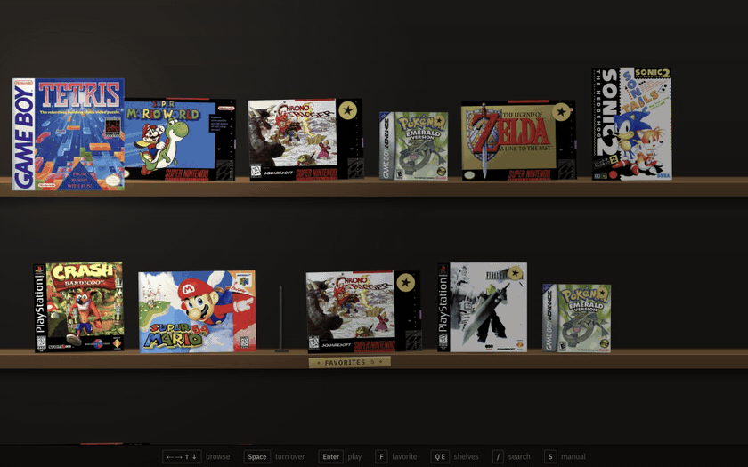
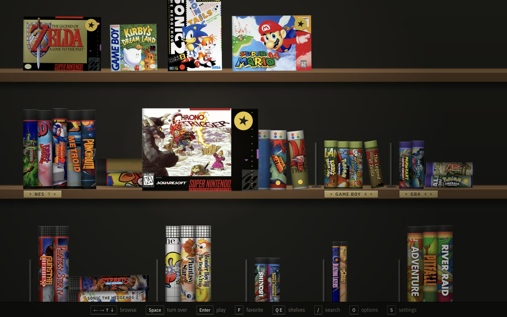
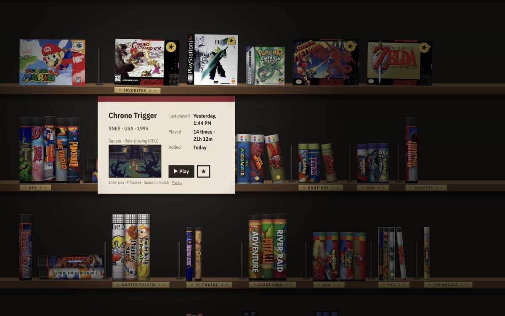
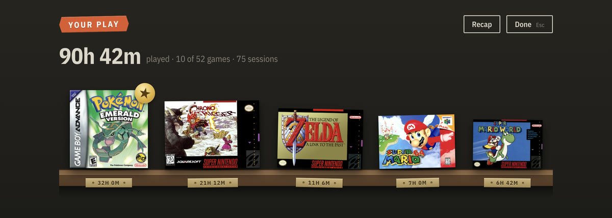
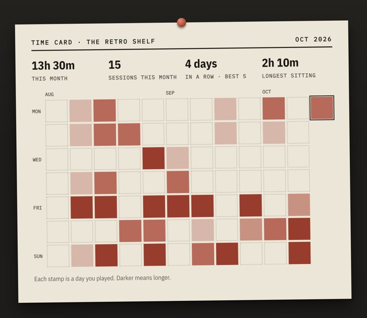
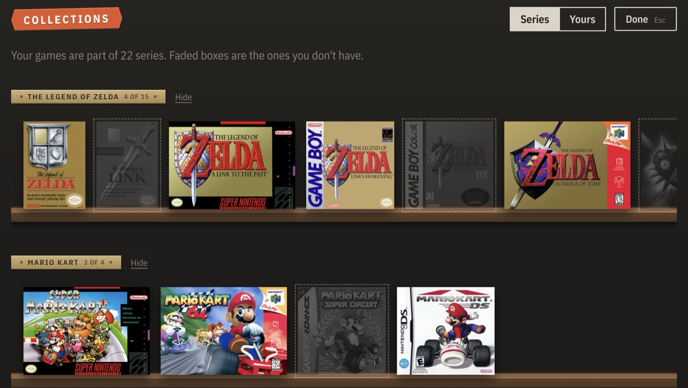
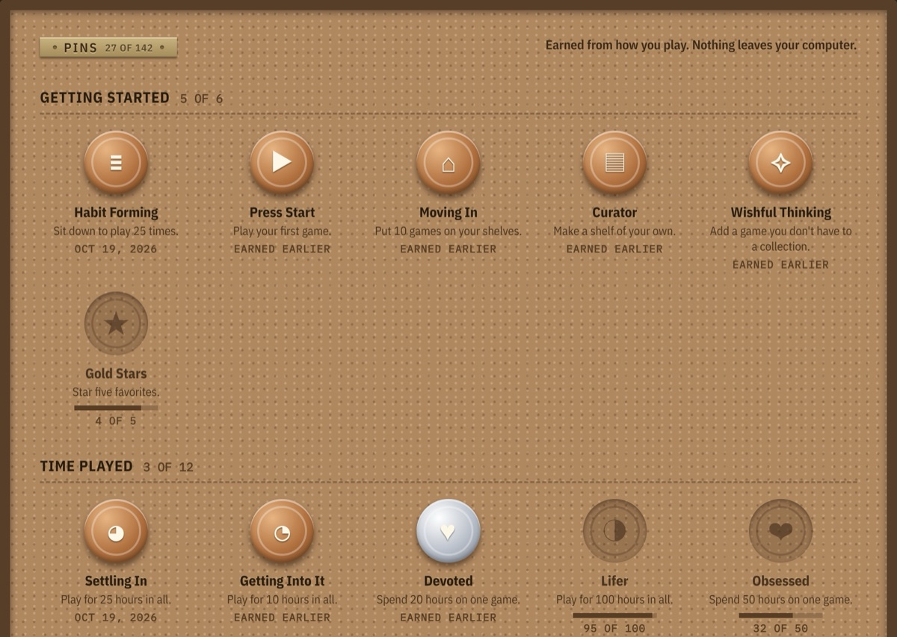

<p align="center">
  
</p>

<h1 align="center">The Retro Shelf</h1>

<p align="center">
  Your retro game collection as real boxes on a shelf.<br>
  Emulators built in. Games not included.
</p>

<p align="center">
  <a href="https://github.com/colingalbraith/the-retro-shelf/releases"></a>
  <a href="https://github.com/colingalbraith/the-retro-shelf/releases"></a>
  <a href="https://github.com/colingalbraith/the-retro-shelf/actions/workflows/test.yml"></a>
  
  <a href="LICENSE"></a>
  <a href="https://github.com/colingalbraith/the-retro-shelf/stargazers"></a>
</p>

<p align="center">
  
</p>

Drag your games onto the window and they land on the right shelf with their box art, ready to play with a
keyboard or controller. RetroArch and its cores come inside the app, so there's nothing else to set up.

## Features

- **A real shelf:** every console has its own box style, with spine art and logos from the game's cover.
- **Pull a box out to play,** or turn it over to see last played, playtime and your saves.
- **Drag-and-drop import** that works out which console each file is for.
- **Pick up where you left off:** leaving a game saves your spot.
- **Art and details are automatic:** covers, logos, year, publisher and genre for 38,000+ games. Wrong cover? Pick
  the right one from a list.
- **Shelves your way:** arrange by console, genre, decade or what you've played; make your own like "Couch co-op";
  sort by title, year or last played.
- **Collections:** every series your games belong to, with the ones you don't have yet standing faded, and wishlists
  of your own.
- **Your play:** a trophy shelf of your most played games, a time card stamped with the days you played, and 208
  pins to earn, no account needed.
- **TV mode:** fullscreen and bigger, and everything works from a controller, with an on-screen keyboard for search.
- **CRT look:** play with sharp pixels, smoothed, or the scanlines of an old TV.
- **Controllers just work:** Xbox, PlayStation and Switch Pro.
- **Saves are safe:** back them all up to one file, and see which BIOS files each console has.
- **Six languages:** English, plus Español, Français, Deutsch, Português and 日本語 (drafts, in beta). Text size and
  screen reader labels too.
- **Updates itself** in the background.
- **Private:** no account, no tracking.

<table>
  <tr>
    <td width="50%"></td>
    <td width="50%"></td>
  </tr>
  <tr>
    <td width="60%"></td>
    <td width="40%"></td>
  </tr>
  <tr>
    <td width="55%"></td>
    <td width="45%"></td>
  </tr>
</table>

## Download

Grab the latest version from [Releases](https://github.com/colingalbraith/the-retro-shelf/releases):

- **Mac with Apple silicon** (M1 and newer): `mac-arm64.dmg`. **Mac with Intel**: `mac-x64.dmg`. Open it and drag
  The Retro Shelf into Applications. Not sure which Mac you have? Apple menu → About This Mac: "Chip" means
  Apple silicon, "Processor" means Intel.
- **Windows** 10 and 11: run the `Setup .exe`.

After that it updates itself.

The app isn't signed by Apple or Microsoft, so the first launch needs an extra step. After that it opens normally,
updates included.

**Mac:**
1. Open The Retro Shelf from Applications. macOS says it can't check the app; click **Done**.
2. Open **System Settings → Privacy & Security** and scroll down to **Security**. Next to "The Retro Shelf was
   blocked to protect your Mac", click **Open Anyway** and confirm with your password or Touch ID.
3. Click **Open Anyway** once more when asked.

**Windows:** if a blue "Windows protected your PC" box appears, click **More info**, then **Run anyway**.

> [!NOTE]
> This is an early beta. [Bug reports](https://github.com/colingalbraith/the-retro-shelf/issues) are welcome.

## Getting games

No games are included, and the app doesn't link to sites that hand out commercial games. Instead you can copy
cartridges and discs you own, play free homebrew, or buy official re-releases. The app has a guide to all of
these under **Help → Where to Get Games**.

## Supported consoles

NES, SNES, Game Boy, Game Boy Color, Game Boy Advance, Genesis / Mega Drive, Master System, Game Gear, PC Engine,
Atari 2600, N64, DS, PlayStation, PSP, Dreamcast, GameCube, Wii and Arcade. Their emulators come with the app.

<details>
<summary>Which emulator runs each one</summary>

| Console | Emulator | BIOS file |
| --- | --- | --- |
| NES | FCEUmm | Not needed |
| SNES | Snes9x | Not needed |
| Game Boy, Game Boy Color | Gambatte | Not needed |
| Game Boy Advance | mGBA | Not needed |
| Genesis / Mega Drive, Master System, Game Gear, SG-1000 | Genesis Plus GX | Not needed |
| Sega CD / Mega-CD | Genesis Plus GX | Required |
| 32X | PicoDrive | Not needed |
| PC Engine / TurboGrafx-16 | Beetle PCE Fast | Only for CD games |
| Atari 2600 | Stella | Not needed |
| Atari 7800 | ProSystem | Optional |
| Atari Lynx | Handy | Optional |
| ColecoVision | Gearcoleco | Required |
| Intellivision | FreeIntv | Required |
| Vectrex | vecx | Not needed |
| MSX, MSX2 | blueMSX | Not needed (the free C-BIOS comes with the app) |
| Nintendo 64 | Mupen64Plus-Next | Not needed |
| PlayStation | PCSX ReARMed | Optional, improves compatibility |
| Saturn | YabaSanshiro | Required |
| 3DO | Opera | Required |
| Neo Geo CD | NeoCD | Optional |
| Dreamcast | Flycast | Optional |
| Nintendo DS | melonDS DS | Optional |
| PSP | PPSSPP | Not needed |
| Neo Geo Pocket, Neo Geo Pocket Color | Beetle NeoPop | Not needed |
| WonderSwan, WonderSwan Color | Beetle WonderSwan | Not needed |
| Virtual Boy | Beetle VB | Not needed |
| Pokémon Mini | PokeMini | Optional |
| GameCube, Wii | Dolphin | Not needed |
| Arcade | FinalBurn Neo | Not needed (romsets named like `sf2.zip`) |
| PlayStation 2 | PCSX2, installed separately | Required |

All of them run inside [RetroArch](https://www.retroarch.com), which comes with the app. BIOS files are copied from
your own console: drop them on the window and they go in the right place. Settings → Saves & BIOS shows what each
console has.

</details>

## Controls

| Keyboard | Controller | |
| --- | --- | --- |
| Arrows | D-pad | Browse |
| Enter | A | Play |
| Space | Y | Turn box over |
| F | X | Favorite |
| Esc | B | Back |

In a game, hold **Start** or press **Esc** to return to the shelf.

## Build from source

You need [Node.js 22](https://nodejs.org).

```sh
npm install
npm run fetch:mac   # or fetch:win: downloads RetroArch and the cores
npm start
npm test
npm run dist:mac    # or dist:win
```

Pushing a `v*` tag builds the installers in GitHub Actions and attaches them to a draft release. Publishing it is
what the app's updater picks up.

## License

[GPL-3.0-or-later](LICENSE). The bundled RetroArch and cores keep their own licenses
([THIRD_PARTY_NOTICES.md](THIRD_PARTY_NOTICES.md)). Some cores are non-commercial, so the app can't be sold.
Box art comes from libretro-thumbnails and belongs to its owners. This project isn't affiliated with any
console maker.

## Star history

<a href="https://star-history.com/#colingalbraith/the-retro-shelf&Date">
  
</a>
